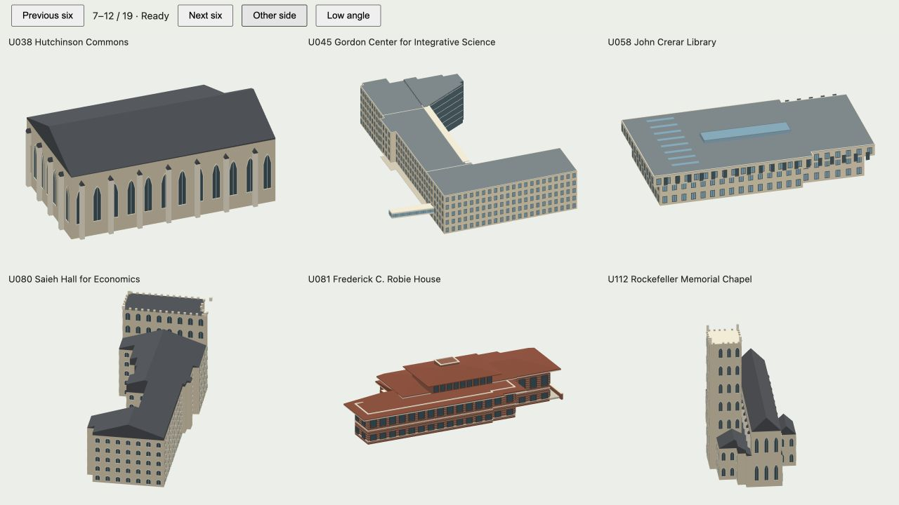

# Architectural Highlight form review

Reviewed 18 October 2026: all 19 building Highlights.

This audit records the individual massing, roof, entrance, facade and characteristic assemblies. A generic window-frame count is not evidence of architectural agreement. Official footprints and published heights remain distinct from photo-based estimates. Previously corrected presentation cameras and dedicated Alder/Suzzallo assemblies are preserved.

| Code | Highlight | Decision | Features reviewed | Reference |
|---|---|---|---|---|
| U002 | Campus North Residential Commons | retained existing individual exterior after review | Three towers at different five/eleven/fifteen-storey heights; Interlocking open courtyards; Separate low commons wings; Recessed glazing and planted roofs | [Reference](https://studiogang.com/projects/university-of-chicago-campus-north-residential-commons/) |
| U003 | Gerald Ratner Athletics Center | reconstructed source-specific exterior | two sports halls and lower round entrance lobby; continuous flattened S-curve metal roofs; inclined glazed end walls; five leaning mast pairs; 120 roof-attached stay cables; clerestory bands and standing seams | [Reference](https://architecture.uchicago.edu/locations/gerald_ratner_athletics_center/) |
| U022 | Joseph Regenstein Library | retained existing individual exterior after review | Slipped limestone research-library segments; Mapped deep facade grooves and projecting bays; Five above-ground levels; Separate set-back mechanical penthouse | [Reference](https://www.lib.uchicago.edu/spaces/joseph-regenstein-library/) |
| U024 | Joe and Rika Mansueto Library | retained existing individual exterior after review | Elliptical glass shell; Bidirectional steel lattice at roughly six-foot spacing; Published 35-foot dome peak; Lower library connection; underground storage excluded from above-ground mass | [Reference](https://www.lib.uchicago.edu/mansueto/tech/numbers/) |
| U028 | William Eckhardt Research Center | retained existing individual exterior after review | Glazed research building at published overall height; Set-back rooftop service enclosure; Horizontal glazing bands and metal floor edges; Lower mapped companion wings | [Reference](https://www.thorntontomasetti.com/project/eckhardt-research-center) |
| U032 | Mitchell Tower | reconstructed source-specific exterior | square limestone Gothic tower; true open ground-level cross passage; deep bell-stage arches; four corner turrets; crenellated parapet; paired narrow Gothic lights | [Reference](https://architecture.uchicago.edu/locations/tower_group_mitchell_tower_hutchinson_commons_reynolds_club_mandel_hall/) |
| U038 | Hutchinson Commons | retained existing individual exterior after review | Single-storey Gothic great hall; Tall pointed traceried lights; Wall-attached external buttresses; Steep slate hall roof with connected end enclosure | [Reference](https://architecture.uchicago.edu/locations/tower_group_mitchell_tower_hutchinson_commons_reynolds_club_mandel_hall/) |
| U045 | Gordon Center for Integrative Science | reconstructed source-specific exterior | separate limestone research wings; tall glazed eastern hinge atrium; open ground-level breezeway; six-storey-height steel colonnade; glazed upper bridge and limestone canopy | [Reference](https://architecture.uchicago.edu/locations/gordon_center_for_integrative_science/) |
| U058 | John Crerar Library | reconstructed source-specific exterior | three above-ground library levels; 11-foot upper-floor cantilever; vertical narrow concrete window bays; central atrium roof lantern; 2018 roof skylights | [Reference](https://www.lib.uchicago.edu/crerar/about-crerar-library/history/) |
| U080 | Saieh Hall for Economics | retained existing individual exterior after review | Former seminary/church mass; Distinct west entrance tower; Individual pitched slate wings; Crenellated masonry parapets and Gothic bays | [Reference](https://architecture.uchicago.edu/locations/department_of_economics_and_becker_friedman_institute/) |
| U081 | Frederick C. Robie House | reconstructed source-specific exterior | long Roman-brick living/dining bar; deep low hipped clay eaves with limestone fascia; 24 art-glass door bays along the south balcony; upper bedroom mass; central chimney; brick terraces, parapets and urns | [Reference](https://flwright.org/explore/frederick-c-robie-house) |
| U112 | Rockefeller Memorial Chapel | retained existing individual exterior after review | Separate published-height bell tower; High central nave and lower aisles; Individual steep roof ranges; Repeated stepped buttresses and tall pointed lights | [Reference](https://www.rockefeller.uchicago.edu/the-spaces/rockefeller-architecture/) |
| U136 | Harper Memorial Library | retained existing individual exterior after review | Two Gothic library end towers; Lower central reading hall; Independent steep slate roofs; Crenellated crowns and tall hall glazing | [Reference](https://campub.lib.uchicago.edu/text/?docId=mvol-0001-0016-0000) |
| U143 | Rubenstein Forum | retained existing individual exterior after review | Two-storey forum base; Four shifted and rotated two-floor tower neighborhoods; Zinc sidewalls and glazed ends; Published completed height retained | [Reference](https://global.ctbuh.org/resources/papers/4631-Gallagher_DavidRubensteinForum.pdf) |
| U148 | Harris School of Public Policy Keller Center | retained existing individual exterior after review | Three-storey limestone academic block; Set-back glazed fourth floor; Planted roof and bounded PV patches; Exterior colonnade rhythm | [Reference](https://architecture.uchicago.edu/locations/keller_center/) |
| U149 | Edith Abbott Hall / Crown Family School | retained existing individual exterior after review | Low horizontal Mies brick enclosure; Continuous two-level steel/glass frontage; Exposed dark frame and thin flat roof; University-specific model; IIT Crown Hall dimensions not substituted | [Reference](https://architecture.uchicago.edu/locations/crownschool/) |
| U155 | Logan Center for the Arts | retained existing individual exterior after review | Published-height stone arts tower; Long low studio and theater wings; Sawtooth studio roof lights; Large glazed performance-room and projecting window volumes | [Reference](https://news.uchicago.edu/story/reva-and-david-logan-center-arts-preview-period-begin-march-26) |
| U157 | Laird Bell Law Quadrangle | retained existing individual exterior after review | Six-level law library block; Lower teaching and administration wings; Glazed concave/convex facade rhythm; Mapped reflection pool and sculpture grounds | [Reference](https://architecture.uchicago.edu/locations/laird_bell_law_quadrangle/) |
| U166 | Woodlawn Residential & Dining Commons | retained existing individual exterior after review | Distinct high and lower residence towers; Mapped irregular commons plan; Published planning height datums retained as planning data; Pale facade frames and separated roof plates | [Reference](https://www.turnerconstruction.com/projects/woodlawn-residential-dining-commons) |

Browser review uses the actual exported 3DS building layers at the presentation view and the opposite side; focused low-angle views check open structures. Geometry, terrain contact, lossless compression, offline bytes and presentation framing are separately checked. This is a public-source exterior study, not surveyed BIM.

## Local browser review

Run `npm run build:highlight-review`, serve the repository locally and open `tmp/highlight-review.html` for the six-building review grid. Add `?code=` followed by a code from the table for a focused full-source view. This development gallery does not apply runtime LOD or ship as part of the public map.
